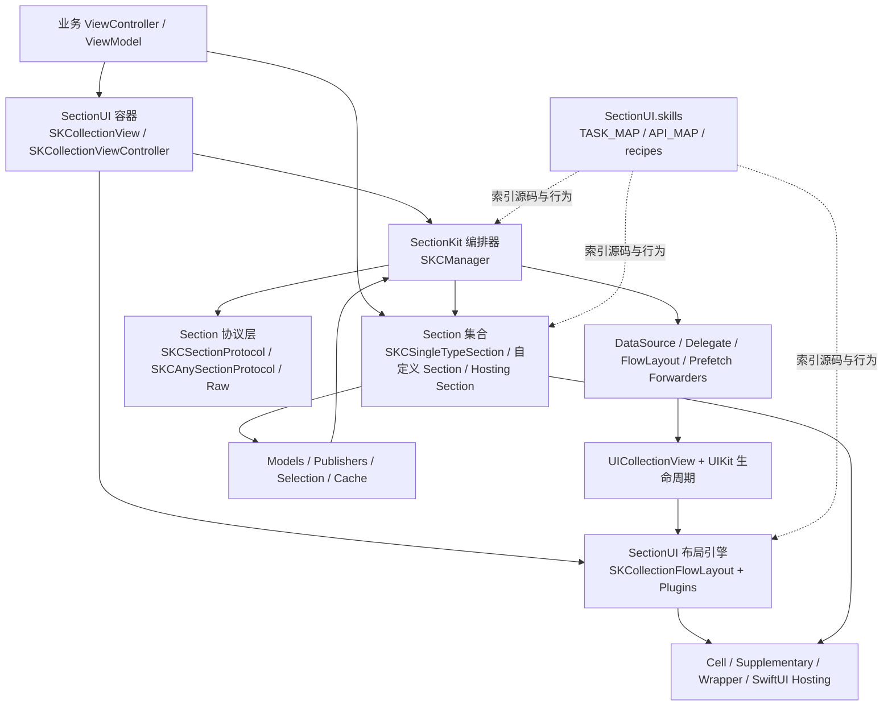
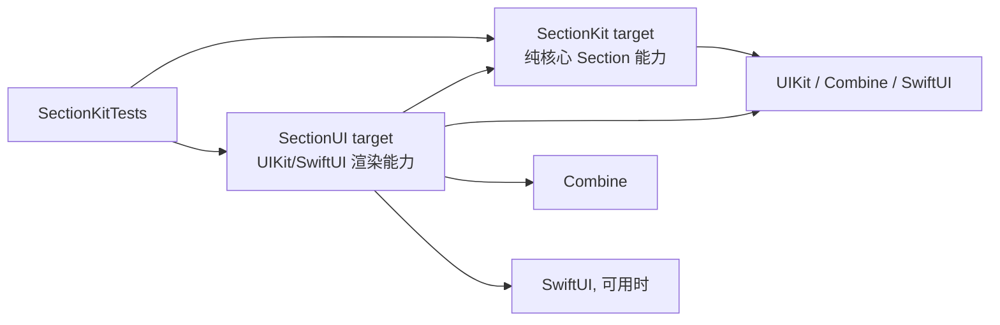
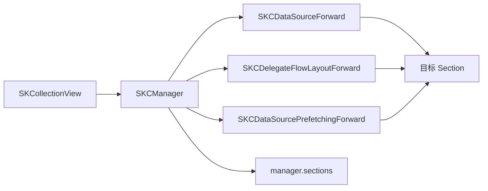
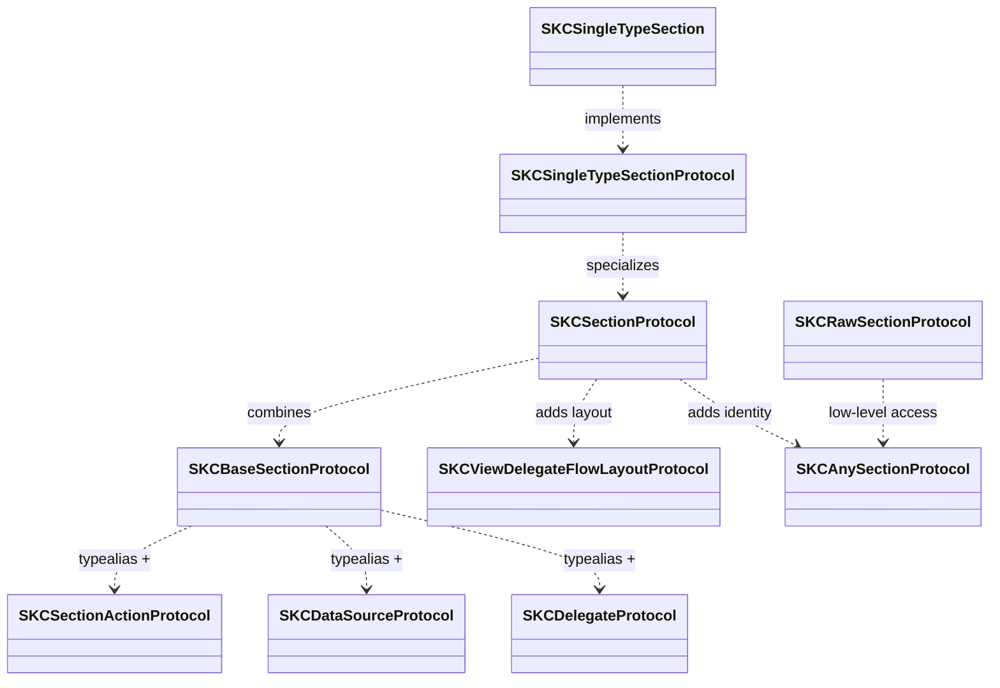
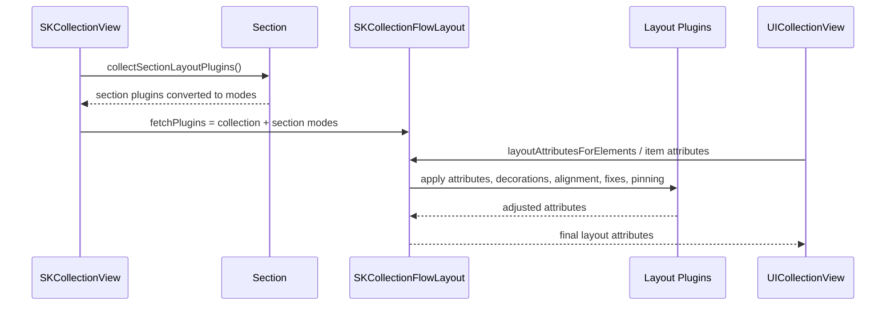
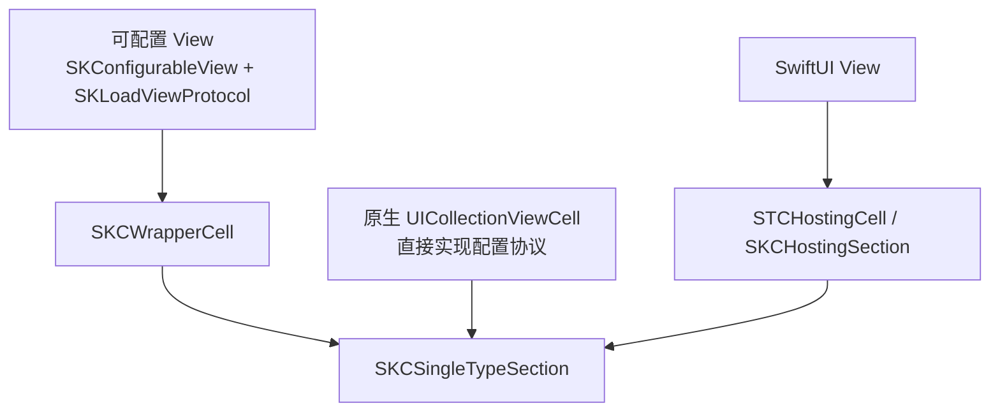

# SectionKit / SectionUI Architecture Map

> 用途：作为 `sectionui` skill 的架构总览和索引入口。先读本页确定模块边界，再按任务打开 `TASK_MAP.md`、`API_MAP.md` 或具体 recipe。
>
> 事实基线：本文按当前仓库的 `Package.swift`、`Sources/SectionKit`、`Sources/SectionUI` 和 `SectionUI.skills` 编写。具体 API 签名以源码为准。

## 1. 总览

SectionKit / SectionUI 将 `UICollectionView` 拆成可组合的 Section：

- `SectionKit`：协议、Section 数据、生命周期、更新事务、事件转发、数据绑定和性能基础设施。
- `SectionUI`：UIKit 容器、Cell/View 包装、布局插件、装饰视图、选择交互、页面与 SwiftUI 桥接。
- `Example`：使用层样例，展示列表、数据更新、交互、布局和响应式绑定。
- `SectionUI.skills`：给 agent 使用的任务路由、API 路由、生产 recipes 和示例。



## 2. SwiftPM target 依赖



当前包声明：

- 产品 `SectionKit` 对应 target `SectionKit`。
- 产品 `SectionUI` 对应 target `SectionUI`。
- `SectionUI` 依赖 `SectionKit`。
- 平台最低为 iOS 13；Swift tools version 为 5.8。
- SwiftUI hosting 相关类型额外受 iOS 可用性约束，当前 `SKCHostingSection` 标注为 iOS 16+。

## 3. 模块与源码入口

### 3.1 SectionKit：协议与状态核心

| 模块 | 关键职责 | 代表入口 |
| --- | --- | --- |
| `Core/Manager` | Manager、Section 注入、更新事务和尺寸提供 | `Sources/SectionKit/Core/Manager/SKCManager.swift`, `SKCSectionInjection.swift` |
| `Core/Protocols` | Section 的数据源、代理、流式布局、预取和类型擦除协议 | `Sources/SectionKit/Core/Protocols/SKCSectionProtocol.swift`, `SKCAnySectionProtocol.swift`, `SKCRawSectionProtocol.swift` |
| `Sections/SingleType` | “一个 Cell 类型 + 一个 Model 类型”的主力实现，按 Core、Context、Behavior、Supplementary、Performance、Protocols 分组 | `Sources/SectionKit/Sections/SingleType/Core/SKCSingleTypeSection.swift` 及其 extensions |
| `ViewConfiguration` | Cell/View/Model 配置协议、自适应尺寸、加载和布局方向 | `Sources/SectionKit/ViewConfiguration/Configurable/SKConfigurableView.swift`, `Loading/SKLoadViewProtocol.swift` |
| `Binding` / `Composition` | 数据绑定、发布、Result Builder 和条件 Section 组合 | `Sources/SectionKit/Binding/SKBinding.swift`, `Composition/SKCSectionCollector.swift` |
| `Performance` | 尺寸/状态缓存、曝光次数和高性能存储 | `Sources/SectionKit/Performance/SKHighPerformanceStore.swift`, `SKKVCache.swift`, `SKCountedStore.swift` |
| `Support` | 基础包装、事件、环境、诊断和小型工具 | `Sources/SectionKit/Support/` |

### 3.2 SectionUI：渲染与交互扩展

| 模块 | 关键职责 | 代表入口 |
| --- | --- | --- |
| `Containers` | CollectionView 根容器、Controller、Manager 装配 | `Sources/SectionUI/Containers/SKCollectionView.swift`, `SKCollectionViewController.swift` |
| `Layout/Flow` | 对 `UICollectionViewFlowLayout` 的插件化属性处理和 Supplementary 修正 | `Sources/SectionUI/Layout/Flow/SKCollectionFlowLayout.swift`, `SKCLayoutPlugin.swift` |
| `Layout/Section` / `Layout/Decoration` | Section 级插件、装饰视图和 Decoration layout | `Sources/SectionUI/Layout/Section/SKCSectionLayoutPlugin.swift`, `Layout/Decoration/SKCLayoutDecorationPlugin.swift` |
| `Cells` | Wrapper Cell、Supplementary、runtime view cell | `Sources/SectionUI/Cells/SKCWrapperCell.swift`, `SKCWrapperReusableView.swift` |
| `Hosting` | UIKit 与 SwiftUI 宿主桥接、Hosting Section 和预览辅助 | `Sources/SectionUI/Hosting/SKCHostingSection.swift`, `SKUIView.swift` |
| `Interaction/Selection` | 选择状态、序列包装和选择交互模型 | `Sources/SectionUI/Interaction/Selection/SKSelectionState.swift`, `SKSelectionWrapper.swift` |
| `Navigation/Page` | Page controller 和可缩放 ScrollView | `Sources/SectionUI/Navigation/Page/SKPageViewController.swift`, `SKZoomableScrollView.swift` |
| `Experimental` | 尚未纳入稳定主路径的瀑布流和拖拽选择能力 | `Sources/SectionUI/Experimental` |


## 4. 运行时核心关系

### 4.1 容器与 Manager

`SKCollectionView` 是推荐的入口容器。它创建并持有 `SKCManager`，同时默认使用 `SKCollectionFlowLayout`。`SKCManager` 将 UIKit 的数据源、代理、流式布局代理和预取代理安装到 forwarder，再将事件分发给当前 Section。



Manager 的关键职责：

1. 持有当前 Section 数组，并通过 `SKCSectionInjection` 给 Section 提供绑定上下文。
2. 将全局 `IndexPath` 转换为 Section 相对的 row，再调用 Section 的数据源/代理能力。
3. 统一执行 Section 的 insert、remove、reload 和 unbind 事务。
4. 将 UIKit delegate/data source/prefetch 事件通过 forwarder 分发，避免每个 Section 直接接管 CollectionView。
5. 暴露 Section publisher 和布局请求，协调生命周期与布局后的待执行请求。

### 4.2 Section 协议层



使用判断：

- 普通同构列表优先使用 `SKCSingleTypeSection<Cell>`。
- 多种 Cell/Model 混合且需要自定义行分派时，使用自定义 `SKCSectionProtocol` 或 raw section wrapper。
- 需要统一存放异构 Section 时依赖 `SKCAnySectionProtocol` / `SKCBaseSectionProtocol` 的类型擦除能力。
- 需要访问 UIKit 原始行为时才下沉到 `SKCRawSectionProtocol`。

### 4.3 单类型 Section 的数据与视图边界

`SKCSingleTypeSection<Cell>` 约束 Cell 同时满足 `UICollectionViewCell`、`SKConfigurableView` 和 `SKLoadViewProtocol`。因此数据流是：

```mermaid
flowchart LR
    Source[业务数据源\n数组 / Publisher / ViewModel]
    Models[Section.models]
    Section[SKCSingleTypeSection<Cell>]
    Register[Cell 注册与生命周期绑定]
    Size[preferredSize / safeSize / adaptive sizing]
    Cell[Cell.config(model)]
    Actions[Cell action / selection / context menu]
    Source -->|config / apply / subscribe| Models
    Models --> Section
    Section --> Register
    Section --> Size
    Section --> Cell
    Cell --> Actions
    Actions --> Section
    Section -->|publisher / callback| Source
```

更新原则：

- 影响行数、排序、结构或尺寸的变化：由 Section 的 `apply`、`refresh`、`append`、`insert`、`remove`、`delete` 等 API 驱动。
- Publisher 拥有 Section 数据时，使用 `subscribe(models:)` 或 `SKBinding`，不要让可见 Cell 成为数据源。
- 高频且不影响行高/列表结构的状态，优先放在稳定引用的 Cell ViewModel 上，通过 `@SKPublished` 局部更新。
- Cell 只负责从 Model 配置视图和订阅自身状态；不要把业务数据源藏在可见 Cell 中。

## 5. 布局执行链

布局能力分为三层：Section 提供局部配置，CollectionView 提供全局 plugin modes，`SKCollectionFlowLayout` 按模式处理布局属性。



插件职责索引：

- 属性调整：`SKCLayoutPlugins+AdjustAttributes.swift`
- 装饰背景与 z-index：`SKCLayoutPlugins+Decorations.swift`、`SKCLayoutDecorationPlugin/`
- Header/ Footer 固定：`SKCLayoutPlugins+SectionHeadersPinToVisibleBounds.swift`
- 横向/纵向对齐：`SKCLayoutPlugins+HorizontalAlignment.swift`、`SKCLayoutPlugins+VerticalAlignment.swift`
- Supplementary 尺寸与 inset 修复：`SKCLayoutPlugins+FixSupplementaryViewSize.swift`、`SKCLayoutPlugins+FixSupplementaryViewInset.swift`

作用域选择：

- 只影响一个 Section：使用 Section-level plugin。
- 影响整个 CollectionView：使用 `SKCollectionView.set(pluginModes:)`。
- 需要改变属性集合或 invalidation：使用现有 plugin/forwarding hook；只有框架能力不足时才实现自定义 forward。

## 6. 视图承载模式



推荐选择：

- 纯 UIKit 可复用组件：优先“普通 `UIView` + `SKCWrapperCell`”，把视图逻辑与 CollectionViewCell 解耦。
- 需要复杂 Cell 生命周期或特殊复用行为：直接实现 `UICollectionViewCell` + 配置协议。
- SwiftUI 内容：使用 `SKCHostingSection` / `SKCHostingCell`，并确认系统可用性与 hosting 的尺寸成本。
- Header/Footer：使用 `SKCWrapperReusableView` 或 Section 的 supplementary API。

## 7. 典型调用链

### 首次装配

```text
ViewController
  -> SKCollectionView / SKCollectionViewController
  -> SKCManager(sectionView:)
  -> manager.reload(sections)
  -> SKCSectionInjection.bind/config(sectionView:)
  -> Section 注册 Cell、配置 supplementary、发布 loaded 生命周期
  -> UICollectionView reload / layout
```

### 数据驱动刷新

```text
Publisher / ViewModel
  -> section.subscribe(models:) 或 section.config/apply
  -> Section.models publisher
  -> manager.reload(section) 或 section.refresh(...)
  -> UICollectionView 批量更新 / reload
  -> Cell.config(model)
```

### 用户交互

```text
UICollectionView delegate/data source event
  -> Forwarder
  -> SKCManager 按 section index 路由
  -> Section item(row) / action handler
  -> section publisher / closure
  -> ViewModel 或业务协调器
```

### 布局变化

```text
Section plugin + collection plugin modes
  -> SKCollectionFlowLayout
  -> attributes / decoration / supplementary adjustment
  -> invalidation 或 layoutSubviews request
  -> UIKit 重算并显示
```

## 8. Skills 路由

| 需要理解的层 | 先读 | 再读 |
| --- | --- | --- |
| 总体架构、分组方式、source of truth | `architecture-map.md`（本文） | `data-driven-best-practices.md` |
| Manager 装配、Section 增删改、身份和事务 | `manager-transaction-recipes.md` | `container-lifecycle-recipes.md` |
| Section 组合、异构 Section、builder | `composition-styling-recipes.md` | `render-builder-recipes.md`、`custom-section-patterns.md` |
| Cell/View 容器与 SwiftUI | `view-cell-container-recipes.md` | `runtime-view-wrapper-recipes.md`、`swiftui-hosting-recipes.md` |
| 数据绑定、局部状态和反馈环 | `data-driven-best-practices.md` | `reactive-binding-recipes.md` |
| 行变更、刷新和高频更新 | `row-mutation-recipes.md` | `cache-exposure-recipes.md` |
| 尺寸、布局、装饰、插件 | `layout-plugin-execution-recipes.md` | `layout-decoration-recipes.md`、`safe-size-measurement-recipes.md` |
| 选择、交互、预取和代理转发 | `interaction-state-recipes.md` | `selection-ownership-recipes.md`、`delegate-interaction-recipes.md` |
| 页面、滚动和缩放 | `navigation-scroll-recipes.md` | `page-zoom-recipes.md` |
| 具体类型/API | `API_MAP.md` | 对应源码文件 |

## 9. 维护规则

- 新增公共架构模块时，同时更新本页的模块表和 `API_MAP.md`。
- 新增用户任务或行为时，先在 `TASK_MAP.md` 增加路由，再添加 recipe。
- recipe 描述行为和使用约束；本页描述边界、依赖和调用链，避免两者重复维护同一段细节。
- 文档与源码冲突时，以 `Sources/SectionKit` / `Sources/SectionUI` 的实际签名为准，并在对应 reference 中修正过时描述。
- 运行 skill 校验：`python3 -m unittest discover -s SectionUI.skills/tests`。
